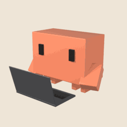
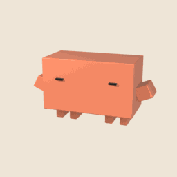

# Clawd 動畫小圖（sprites）

用 Blender 渲染的 Clawd 小角色動畫，透明背景 PNG，每張 256×256，三種狀態都是可以無縫循環的動畫。

| 狀態 | 幀數 | 動作 |
|---|---|---|
| `idle` | 24 | 輕輕上下晃動，眨一次眼 |
| `typing` | 16 | 打開筆電，雙手輪流打字 |
| `tired` | 32 | 身體壓扁、眼睛快閉上、慢慢呼吸 |

| idle | typing | tired |
|---|---|---|
|  |  |  |

## 檔案結構

```
scripts/clawd_sprites.py   渲染腳本
sprites/<狀態>/f000.png …  渲染好的每一幀
previews/<狀態>.gif        預覽用的動畫 GIF
```

## 自己重新渲染

需要 Blender 4.x 以上：

```bash
cd scripts
blender --background --factory-startup --python clawd_sprites.py -- all
```

只想先看兩幀確認效果，可以加上 `preview`：

```bash
blender --background --factory-startup --python clawd_sprites.py -- idle preview
```

## Clawd 介面小外掛（clawd-buddy）

把 Clawd 放在 Claude Code 的輸入框正上方：

| 什麼時候 | Clawd |
|---|---|
| Claude 正在工作 | 對著筆電打字 |
| 閒置 | 輕輕晃動、眨眼 |
| 超過 10 分鐘沒動靜，或一次工作超過 5 分鐘 | 累到壓扁 |

輸入 `/clawd` 可以隱藏或叫回 Clawd。

**可以顯示的地方：** Claude 桌面 App、手機 App（會動的動畫），以及終端機（靜態圖，需要支援圖片的終端機）。瀏覽器版 claude.ai 目前不會顯示這類外掛。

### 安裝

在 Claude Code 的輸入框輸入：

```
/plugin install clawd-buddy --marketplace chenyouren0318-glitch/-1
```

問你是否加入 marketplace 時回答 `y`，再選安裝範圍。

或在終端機（shell）執行：

```bash
claude plugin install clawd-buddy --marketplace chenyouren0318-glitch/-1
```
