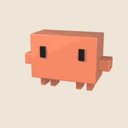

# Clawd 動畫小圖（sprites）

用 Blender 渲染的 Clawd 小角色動畫，透明背景 PNG，每張 256×256，三種狀態都是可以無縫循環的動畫。

| 狀態 | 幀數 | 動作 |
|---|---|---|
| `idle` | 24 | 輕輕上下晃動，眨一次眼 |
| `typing` | 16 | 打開筆電，雙手輪流打字 |
| `tired` | 32 | 身體壓扁、眼睛快閉上、慢慢呼吸 |

| idle | typing | tired |
|---|---|---|
|  |  |  |

## 檔案結構

```
scripts/clawd_sprites.py   渲染腳本
sprites/<狀態>/f000.png …  渲染好的每一幀
previews/<狀態>.gif        預覽用的動畫 GIF
```

## 自己重新渲染

需要 Blender 4.x 以上：

```bash
cd scripts
blender --background --factory-startup --python clawd_sprites.py -- all
```

只想先看兩幀確認效果，可以加上 `preview`：

```bash
blender --background --factory-startup --python clawd_sprites.py -- idle preview
```
